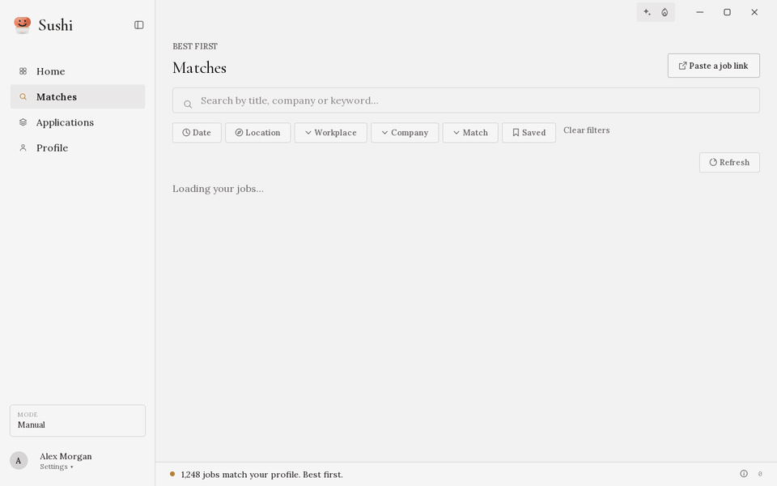

<div align="center">


# Sushi

**Sushi is Open-source AI job application that autofill and finds jobs from your CV and fills applications on Greenhouse, Lever, Workday and more. Local-first. It finds jobs that fit and fills in the applications for you.**

A local-first desktop app for job seekers. Your CV, your answers and your
history stay on your computer.




<sub>Insane Mode at work: best matches first, each form filled and left for you to check.</sub>

</div>

---

## Contents

- [Overview](#overview)
- [Features](#features)
- [Requirements](#requirements)
- [Installation](#installation)
- [Usage](#usage)
- [Configuration](#configuration)
- [Where your data lives](#where-your-data-lives)
- [How it works](#how-it-works)
- [Privacy and safety](#privacy-and-safety)
- [Development](#development)
- [Troubleshooting](#troubleshooting)
- [Known limitations](#known-limitations)
- [Contributing](#contributing)
- [Security](#security)
- [Licence](#licence)
- [Credits](#credits)

## Overview

Applying for jobs means typing the same work history into dozens of forms.
Sushi reads your CV once, finds roles that match it on companies' own careers
pages, opens each application in a real browser and fills it in. Anything it
cannot answer from your CV is left for you, and every answer you give is
remembered for the next form.

## Features

| Feature | What it does |
|---|---|
| **CV reading** | Reads a PDF, DOCX or TXT CV, builds your profile, and flags anything it inferred so you can correct it. |
| **Job discovery** | Reads jobs directly from 26,000+ companies' careers pages through their public ATS APIs, often days before job boards list them, plus eight job-feed sites. Refreshed daily. |
| **Explained matches** | Every job gets a match score and the reasons behind it. |
| **Form filling** | Opens the application in a real browser and fills every kind of field: dropdowns, radio buttons, typeaheads, dates, uploads and follow-up questions. |
| **Insane Mode** | Works through your best matches on its own, up to a daily limit you set. |
| **Answer memory** | Learns from every answer you type or correct, so each application needs less from you. |
| **Cover letters** | Writes a letter tailored to each role and saves it as a normal file. |
| **Application tracking** | One list of every application by status, with CSV export. |
| **Assistant** | A side panel you can ask about your matches or tell to act, with every action previewed. |

## Screens

| Screen | Purpose |
|---|---|
| **Home** | The Insane Mode switch, daily limit and Pause; new matches, sent today and needs-your-input at a glance; questions only you can answer, answered in place; and what was filled today. |
| **Matches** | Every job above the bar, best first, each with why it matched. Filter, search, skip or apply, or paste a link to any job posting. |
| **Applications** | Everything filled or sent, by status: Submitted, In flight, Needs you, Failed, Skipped. |
| **Profile** | Your CV library, resume builder with PDF export, cover letter and the profile read from your CV. |
| **Settings** | Where to look, apply behaviour, what Sushi has learned, model, files and companies. |

## How Insane Mode works

1. Turn on the Insane Mode switch on Home.
2. Sushi takes your best matches, opens each application in a real browser and
   fills it in.
3. Questions it would have to guess (salary, visa status, notice period) are
   left blank and collected under **Needs you** on Home.
4. It stops at your daily limit.
5. You check each form and press Submit. Submitting without review is off by
   default and has to be confirmed before it can be turned on.

## How it learns

The first application needs some help from you; later ones need very little.
While a form is open, Sushi records what is in each field:

- A value Sushi typed is saved as a **guess**.
- A value you typed or corrected is saved as a **correction**. A correction is
  never overwritten by a guess.
- Questions worded differently but meaning the same thing are recognised as
  one, so you answer each only once.

Passwords, one-time codes and bank details are never stored. Everything Sushi
has learned can be reviewed and deleted under **Settings → Learning**.

## Model costs

A browser agent reads a lot (roughly 320,000 tokens per application), so Sushi
shows what each model costs before you choose one.

| Model | Key | Cost per application |
|---|---|---|
| Claude Code (if installed) | None | Nothing extra; uses your Claude Code limits |
| Groq | Free key | Free within the free tier |
| Gemini Flash | Free key | Free tier, then about $0.03 |
| OpenAI gpt-4o-mini | Paid | About $0.05 |
| Claude Haiku | Paid | About $0.34 |
| Ollama (local) | None | Free; nothing leaves your computer |

## Requirements

- Python 3.11 or later, with `venv` or `virtualenv`
- Windows, macOS or Linux
- About 1 GB of free disk space for dependencies and the Chromium browser
- A model to drive the browser: a free or paid API key, Claude Code, or a
  local Ollama install (see [Model costs](#model-costs))

## Installation

```bash
git clone https://github.com/getsushi/sushi.git
cd sushi
python -m venv .venv
```

Activate the environment:

```bash
# Windows
.venv\Scripts\activate
# macOS / Linux
source .venv/bin/activate
```

Install the dependencies and the browser:

```bash
pip install -r requirements.txt
python -m playwright install chromium
```

`onnxruntime`, `tokenizers` and `numpy` are optional. Without them, the answer
memory matches questions by their words instead of their meaning.

## Usage

```bash
python main.py
```

On first run, add your CV and choose a model; matches start to appear once
the first scan finishes. If a `.venv` folder exists, `main.py` switches to it
on its own, so you can launch with any Python.

## Privacy and safety

These rules are enforced in code, not left to the model:

- **Nothing is sent without your approval.** By default Sushi fills the form
  and waits for you.
- **The model never sees your email or phone number.** They are inserted only
  at the moment of typing.
- **No invented answers.** If Sushi is not sure, it leaves the field blank and
  tells you.
- **Your data stays local.** No account, no cloud, no tracking.

## Responsible use

Sushi is built for quality, not volume: a few well-matched, correctly filled
applications rather than hundreds of careless ones.

- **Daily cap.** Insane Mode applies only to your best matches, up to a limit
  you set (10 a day by default), and never to the same job twice.
- **Review before submit.** Forms are filled and left for you to check by default.
- **Respect each site's terms.** Some job sites restrict automated
  applications. You are responsible for how you use Sushi and for everything
  submitted in your name.

Sushi is provided as is, without warranty of any kind.

## How it works

```
CV ──> profile ──> company careers pages (ATS APIs) + job-feed sites
                                   │
                                   v
                     scored matches, with reasons
                                   │
                                   v
cover letter ──> browser fills the form ──> you review ──> submitted
                                   │
                                   └──> answers and corrections remembered
```

Jobs are read from Greenhouse, Lever, Ashby, Workable, SmartRecruiters,
Recruitee, Workday, Personio, Teamtailor, BambooHR, Breezy, Pinpoint and
Rippling through their public JSON APIs, so no scraping is involved.

## Configuration

### Credentials

Sushi looks for a model key in this order: **Settings → Model**, then a `.env`
file (`OPENAI_API_KEY`, `OPENAI_BASE_URL`, `SUSHI_MODEL`, …), then environment
variables (`ANTHROPIC_API_KEY`, `OPENAI_API_KEY`, `AZURE_OPENAI_API_KEY`). The
app shows which source it used, never the key itself.

Never commit a `.env` file. It is already listed in `.gitignore`.

## Where your data lives

Sushi keeps nothing next to the code that belongs to you.

| What | Where |
|---|---|
| App database, browser profile, logs | Windows: `%LOCALAPPDATA%\sushi`<br>macOS: `~/Library/Application Support/sushi`<br>Linux: `$XDG_DATA_HOME/sushi` (default `~/.local/share/sushi`) |
| CVs, cover letters, tailored resumes | `~/Documents/Sushi` (can be moved in Settings) |

To start completely fresh, close Sushi and delete the app data folder.

## Development

### Project layout

```
main.py                 entry point
sushi/
  cv.py                 CV to profile
  discovery.py          scoring and the feed
  jobsdb.py             local database of jobs
  ats.py                the 13 ATS clients
  sources.py            job-feed sites
  autofill.py           the browser agent
  learning.py           the answer memory
  providers.py          model presets and costs
  ui/                   PyQt6 desktop app
tests/                  unit tests
tools/qa/               end-to-end suites and their fictional test CV
tools/                  developer launchers (a clean first run, board import)
docs/                   documentation and media
```

### Running tests

```bash
python -m pytest tests
```

End-to-end suites live in `tools/qa/` and run from the repository root with
`PYTHONPATH=.`, for example `python tools/qa/qa_fields.py`, which checks that
every kind of form field is filled correctly.

## Troubleshooting

| Problem | Fix |
|---|---|
| `No module named 'PyQt6'` or `'browser_use'` | The dependencies are not installed for the Python you used. Create `.venv` and install `requirements.txt` as shown in [Installation](#installation). |
| `No module named venv` | Your Python was built without `venv`. Run `pip install virtualenv`, then `python -m virtualenv .venv`. |
| `database disk image is malformed` on start-up | The app database is damaged. Close Sushi, copy `sushi.db` from the app data folder somewhere safe, then delete it. Sushi creates a new one on next start; you will need to add your CV again. |
| The browser never opens | Run `python -m playwright install chromium` inside the virtual environment. |

The log file `sushi.log` in the app data folder records every start-up and
error, and is the first thing to attach to a bug report.

## Known limitations

- **Taleo and iCIMS** are not supported yet.
- **No OCR.** A scanned PDF CV is rejected rather than misread.
- **Title matching is word-based**, so an unusually named role can be missed.

## Contributing

Contributions are welcome. To get started:

1. Fork the repository and create a branch from `main`.
2. Set up a virtual environment as in [Installation](#installation).
3. Make your change, and add or update tests in `tests/`.
4. Run `python -m pytest tests` and make sure it passes.
5. Open a pull request that says what changed and why.

For bugs, open an [issue](https://github.com/getsushi/sushi/issues) with your
operating system, Python version, the steps to reproduce, and the relevant part
of `sushi.log`. Remove any personal details from the log first.

The easiest way to contribute is to add a job site. Each one is a small
function in [`sushi/ats.py`](sushi/ats.py): copy `_greenhouse`, register it in
`read_board`, and open a pull request.

Other welcome contributions:

- More job-feed sites in [`sushi/sources.py`](sushi/sources.py)
- Form fields Sushi cannot fill yet: add a case to `tools/qa/qa_fields.py`, then fix it
- Cover letter and resume templates
- Anything in [issues](https://github.com/getsushi/sushi/issues)

## Security

Please do not report security problems in a public issue. Use GitHub's
**Report a vulnerability** button on the repository's Security tab, so the
problem can be fixed before it is made public.

## Licence

Sushi is released under the [MIT License](LICENSE).

## Credits

Sushi's code is its own. These open-source projects were studied for ideas on
job sources, ATS detection and deduplication; none of their code is included.

- ever-jobs (MIT, © Ever Co. LTD)
- freehire (MIT, © freehire contributors)
- job_search (Apache-2.0)
